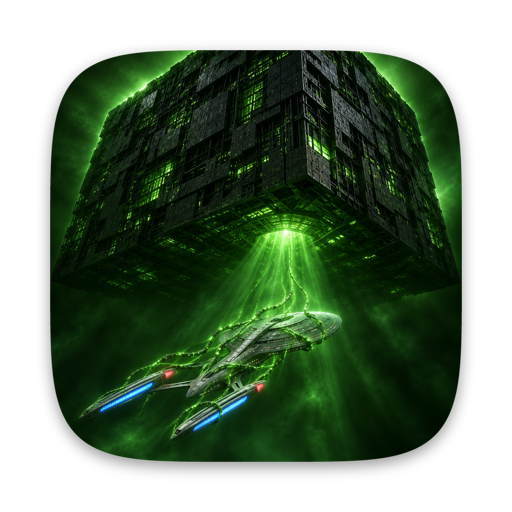
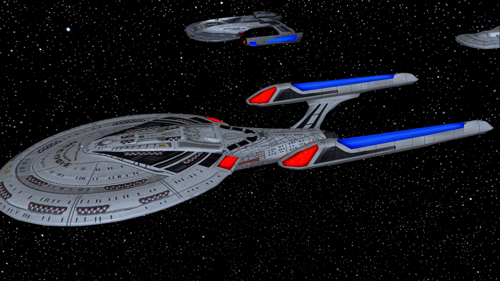
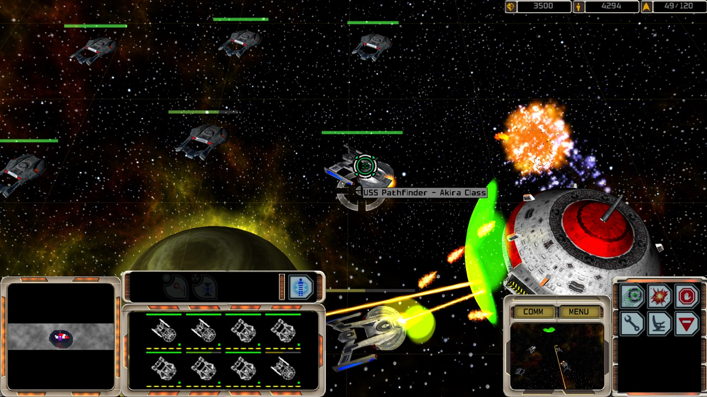
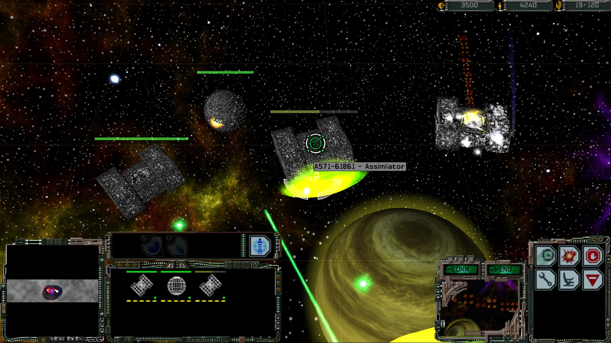
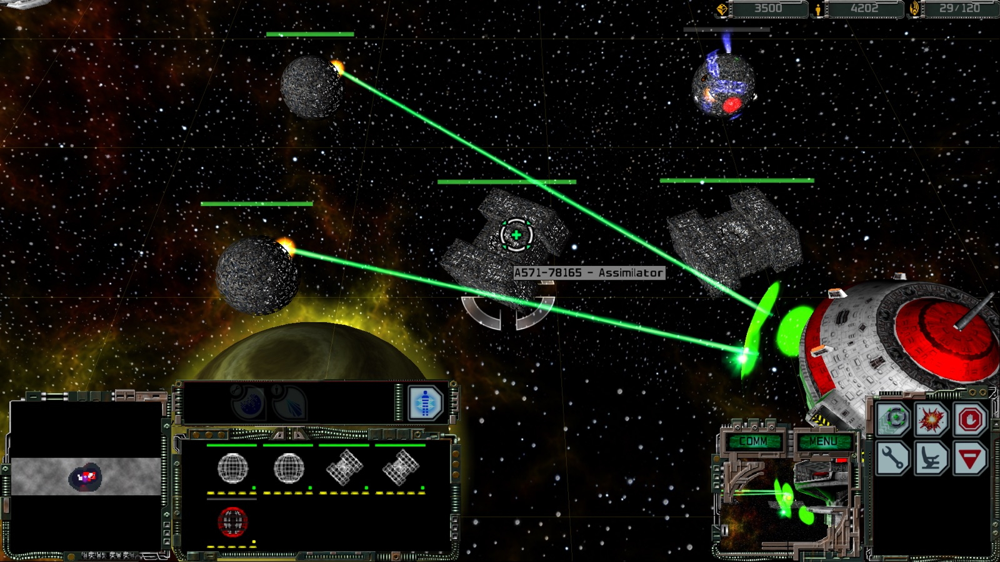
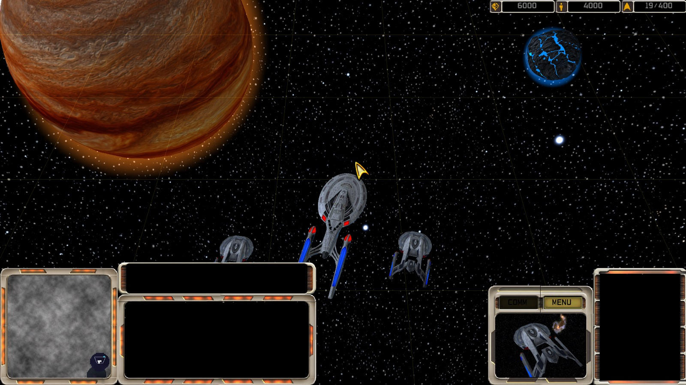
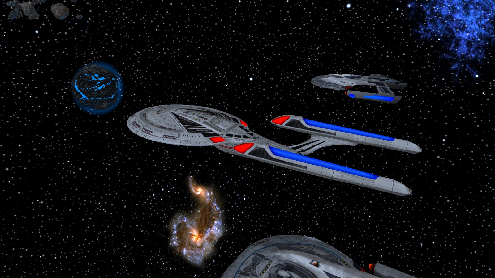
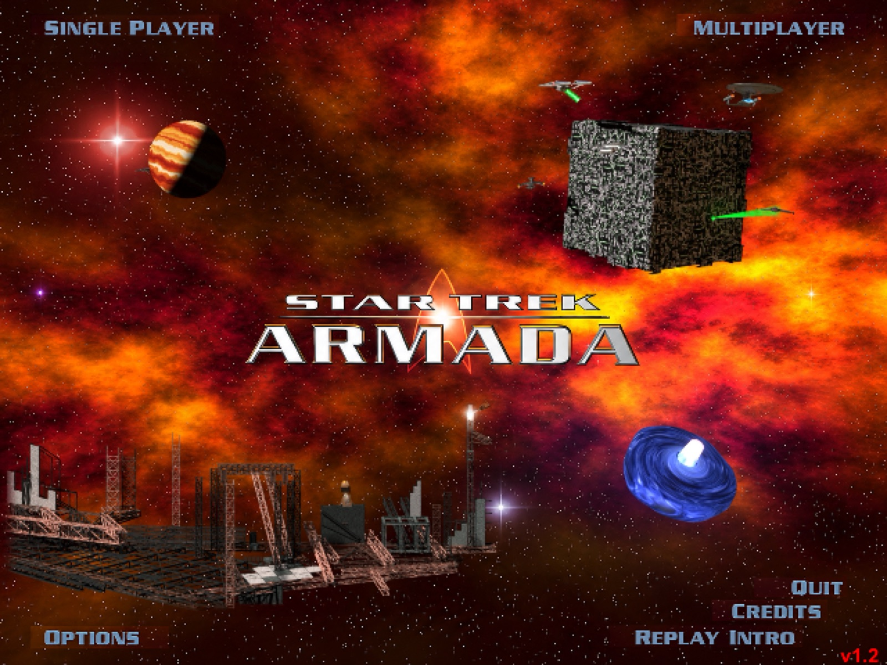

<p align="center">
  
</p>

<h1 align="center">Armada Reforged</h1>

<p align="center"><b>Star Trek: Armada (2000), rebuilt to run natively on Apple Silicon Macs.</b><br>
Federation, Klingon, Romulan and Borg fleets, the full campaign and Instant Action, now on Metal, in Retina and widescreen,<br>
with optional upscaled textures and remodelled ships.</p>

<p align="center">
  <a href="https://github.com/XSnelliusX/ArmadaReforged/releases/latest"><b>Download for Mac</b></a> ·
  <a href="#install">Install</a> ·
  <a href="#whats-new">What's new</a> ·
  <a href="#known-issues">Known issues</a>
</p>

https://github.com/user-attachments/assets/b000a758-88dd-41ef-af2d-1d9e105ee820

> [!IMPORTANT]
> **You need your own copy of Star Trek: Armada.** Armada Reforged contains no game data and does not support piracy.
> Buy the game at **[GOG](https://www.gog.com/en/game/star_trek_armada)**, then point Armada Reforged at it.

## Screenshots

<table>
<tr><td></td><td></td></tr>
<tr><td></td><td></td></tr>
<tr><td></td><td></td></tr>
</table>

<p align="center"></p>

## What is it?

Armada Reforged is a new, native Mac version of the 2000 real-time strategy game *Star Trek: Armada*. It is not an emulator and
does not use Wine: the game's engine was rebuilt from scratch, and it plays the original game files you already own.

Everything the single-player game offers is here:

- **The full campaign**: all 20 missions across the Federation, Klingon, Romulan and Borg chapters and the finale, with their
  cutscenes and bridge scenes.
- **Instant Action** against the original AI on every map, at every difficulty.
- Combat with every weapon and special weapon, resource mining, research, fog of war, music, unit voices and 3D sound.
- **Save and load** at any time, in the campaign and in Instant Action.

## What's new

- Runs natively on Apple Silicon with Metal: sharp on Retina displays, widescreen or the original 4:3, window or fullscreen.
- **The upscaled look (optional)**: HD textures, remodelled ships and stations, and crisp HD fonts. Pick it on first start; it
  downloads in the background while you play and is used from the next start. Switch back to the original look at any time in
  Options.
- A free camera that pans, tilts and zooms.
- Smoother play: models are preloaded during the loading screen, so battles stutter less when new ships appear.
- Safer saves: a damaged save is refused instead of crashing the game.
- Fixes for some of the original's annoyances, for example freighters that stalled beside moons.

## Install

**Requirements:** a Mac with Apple Silicon (M1 or later), macOS 13 Ventura or later, and the original game.

1. Download **Armada Reforged** (`.dmg`) from the [latest release](https://github.com/XSnelliusX/ArmadaReforged/releases/latest)
   and drag it into Applications.
2. Open it. The first time, macOS may say it cannot verify the app (it is a free fan project and is not notarised by Apple):
   open **System Settings > Privacy & Security** and click **Open Anyway**.
3. Choose the folder of your Star Trek: Armada installation (the one with `Armada.exe` in it).
4. Choose **Original** or **Upscaled** look. That's it: play.

<details>
<summary><b>I bought the game on GOG. How do I get its files onto my Mac?</b></summary>

GOG's offline installer is a Windows program, but it can be unpacked on a Mac:

```sh
brew install innoextract            # needs Homebrew: https://brew.sh
innoextract -d ~/Armada ~/Downloads/setup_star_trek*_armada_*.exe
```

Then choose the folder `~/Armada/app` when Armada Reforged asks for the game.
If you have the game on another computer, copying its install folder to your Mac works too.
</details>

<details>
<summary><b>Install from the Terminal instead</b></summary>

```sh
curl -fsSL https://github.com/XSnelliusX/ArmadaReforged/releases/latest/download/install.sh | bash
```

The script installs the app, asks for the look and can unpack the GOG installer for you. Run it again to update.
</details>

<details>
<summary><b>Update, switch look, uninstall</b></summary>

- **Update**: download the new release and replace the app. Your saves and settings stay.
- **Switch look**: Options > Graphics.
- **Uninstall**: delete the app and the folder `~/Library/Application Support/ArmadaNative` (settings, saves and the upscaled
  packs).
</details>

## Known issues

- **No multiplayer.** Internet and LAN play are not available; those menu entries are placeholders.
- Save games from the original Windows game cannot be loaded.
- Only Apple Silicon Macs are supported (no Intel Macs, Windows or Linux).
- Ships can sometimes catch on other objects.
- A save does not resume a voice line or bridge movie that was playing when you saved.
- Not every mission has been played through side by side with the original yet. If something behaves differently,
  please [report it](https://github.com/XSnelliusX/ArmadaReforged/issues).

## Reporting a bug

Open an [issue](https://github.com/XSnelliusX/ArmadaReforged/issues/new/choose) and attach `Logs/logfile.txt` from
`~/Library/Application Support/ArmadaNative/`, the mission or map, and what happened. A save game helps. Please never attach
files of the original game.

## Legal

Armada Reforged is an unofficial fan project. It is not affiliated with or endorsed by Activision, Paramount / CBS Studios or
GOG. Star Trek and Star Trek: Armada are trademarks of their owners. No game data is included; you need a legally obtained copy of
the game. The app is released under the [MIT licence](LICENSE); bundled libraries and the asset packs are covered in
[NOTICE.md](NOTICE.md).
